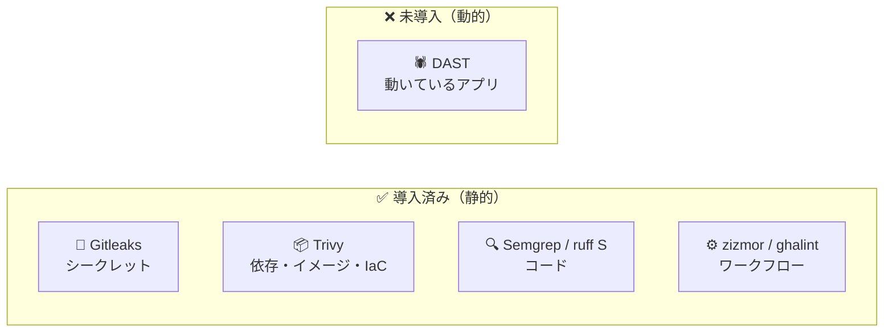
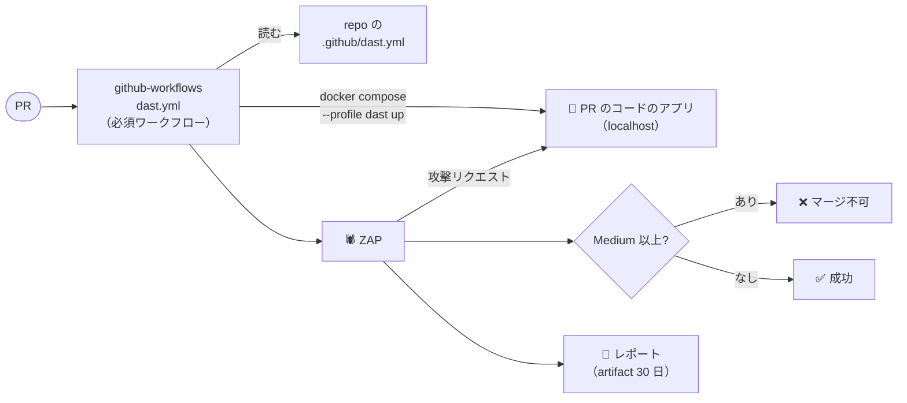
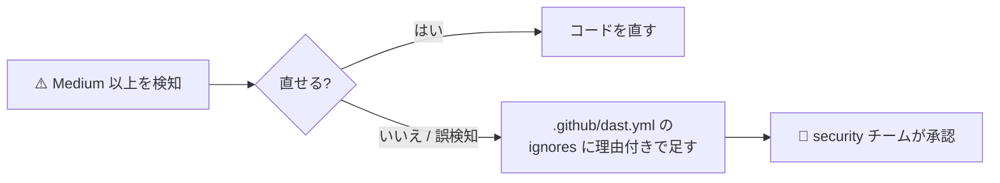
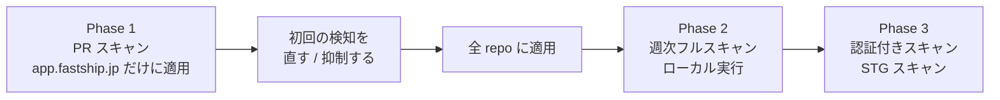

# 🕷️ DAST（動的アプリケーションセキュリティテスト）要件定義・設計

> 📝 ステータス: **設計レビュー中**（実装は未着手）<br/>
> 対象: github-workflows（仕組み）・app.fastship.jp（最初の導入先）

## 1. 🎯 目的
起動したアプリに攻撃リクエストを送り、コードを読むだけでは見つからない脆弱性をマージ前に見つける。



DAST でしか見つからない例: レスポンスヘッダー・Cookie 属性の不備、エラー応答での情報漏えい、実際のエンドポイントへのインジェクション、CORS の設定ミス。

## 2. 📋 要件
### 機能要件

| ID | 要件 |
|:--|:--|
| F1 | PR ごとに、PR のコードから起動したアプリをスキャンする |
| F2 | 画面はクロール＋受動スキャン、API は OpenAPI を元に能動スキャン |
| F3 | **Medium 以上を検知したら失敗**（Trivy と同じ下限）。Low 以下はレポートのみ |
| F4 | 抑制は承認必須の設定ファイルでのみ行い、理由を必須にする |
| F5 | レポートを log に出し、artifact に 30 日保存する |
| F6 | 週次で main をフルスキャン（画面も能動スキャン）し、検知を Issue にする |
| F7 | 設定ファイルの無い repo は skip する（成功扱い） |
| F8 | ローカルでも同じスキャンを実行できる |

### 非機能要件

| 観点 | 要件 |
|:--|:--|
| ⏱️ 時間 | PR は 15 分以内、週次は 60 分以内 |
| 🔐 権限 | `contents: read` のみ・secrets なし・`pull_request` トリガー（既存の必須ワークフローと同じ） |
| 🧯 安全 | PR のスキャン先はランナー内の localhost だけ。デプロイ済みの環境（特に本番）へ能動スキャンしない |
| 📌 再現性 | ZAP のイメージは digest で固定し、Renovate で更新する |
| 🧹 保守 | 10 行以上の `run:` は composite action に切り出す（`ruleset:github-workflows`） |

### 対象外（Phase 3 で再検討）
- ログイン後の画面・API（テンプレートに認証が未実装のため）
- デプロイ済み環境（STG）のスキャン
- 有償 DAST・手動のペネトレーションテスト

## 3. 🧰 ツール選定

| 候補 | 判定 | 理由 |
|:--|:--|:--|
| **ZAP**（旧 OWASP ZAP） | ✅ 採用 | OSS の事実上の標準。OpenAPI の取り込み、手順を YAML 1 ファイルで書ける（Automation Framework）、検知レベルで終了コードを決められる（`exitStatus`） |
| Nuclei | ⏸️ Phase 3 | 既知 CVE・設定ミスの検知が得意。アプリ固有の入力の脆弱性は見ない |
| StackHawk / Burp Suite DAST | ❌ | 有償。StackHawk は中身が ZAP |

ZAP は公式イメージ（`ghcr.io/zaproxy/zaproxy:stable`）を digest 固定で直接実行する。公式 action（`action-baseline` / `action-api-scan` / `action-full-scan`）はスキャン種別ごとに分かれ、既定で Issue を書く（`issues: write` が要る）ため、PR の必須ワークフローでは使わない。

## 4. 🏗️ 設計
### 4.1 全体像
Trivy などと同じく、github-workflows の**必須ワークフロー**で全 repo に強制する。必須ワークフローは inputs を受け取れないため、起動方法とスキャン対象は repo の `.github/dast.yml` で渡す（Trivy の `.github/trivy-image.yml` と同じ方式）。



### 4.2 スキャン内容

| | PR（必須ワークフロー） | 週次（main） |
|:--|:--|:--|
| 🖥️ 画面（`type: web`） | クロール（1 分）＋受動スキャン | ＋ JS 実行込みのクロール（AJAX Spider）＋能動スキャン |
| 🔌 API（`type: api`） | OpenAPI から全エンドポイントを能動スキャン（10 分上限） | 同じ（30 分上限） |
| 🚦 判定 | Medium 以上で失敗 | Medium 以上で Issue を起票 |
| 🧩 実装 | `.github/workflows/dast.yml` | `.github/workflows/dast-weekly.yml`（reusable） |

どちらも共通の composite action（`.github/actions/dast`）で「アプリ起動 → URL の応答待ち → ZAP 実行 → レポート保存」を行う。

### 4.3 repo 側の設定（app.fastship.jp の例）
`.github/dast.yml`

```yaml
# docker compose --profile dast up -d で起動する
compose_profile: dast
targets:
  - url: http://localhost:3000
    type: web                  # 画面: クロール + 受動スキャン
  - url: http://localhost:8000
    type: api                  # API: OpenAPI から能動スキャン
    openapi: /openapi.json
# 抑制（security チームの承認が要る）
ignores:
  - rule: 10055                # CSP
    url: ^http://localhost:3000/
    reason: next.config.ts のとおり、静的シェルを使うため script-src に 'unsafe-inline' を許す
```

`compose.yaml` に追記（`dast` プロファイルなので `task dev:up` には影響しない）

```yaml
  api:
    profiles: [dast]
    build: { context: backend, target: api }
    environment:
      ENV_FOR_PY: local        # /openapi.json を CI のコンテナでだけ公開する
    ports: ["127.0.0.1:8000:8000"]
  frontend:
    profiles: [dast]
    build: { context: frontend, target: runner }
    ports: ["127.0.0.1:3000:3000"]
```

DB が要るようになったら、`db` は既にプロファイル無しで起動するため、migration を `depends_on` で足すだけで済む。

### 4.4 判定と抑制



- `.github/dast.yml` を「✔️ セキュリティ設定変更の承認必須化」の File patterns に足す。削除による opt-out も承認が要る
- ZAP にはインラインの抑制コメントが無いため、Trivy / Semgrep のような禁止処理は要らない

## 5. 🔧 変更するファイル

| repo | ファイル | 内容 | Phase |
|:--|:--|:--|:--:|
| github-workflows | `.github/actions/dast/` | 起動・ZAP 実行・レポート保存の composite action | 1 |
| github-workflows | `.github/workflows/dast.yml` | PR の必須ワークフロー | 1 |
| github-workflows | `docs/SETUP.md` | 必須ワークフローと承認必須ファイルに追加 | 1 |
| app.fastship.jp | `.github/dast.yml` / `compose.yaml` | スキャン対象と起動方法 | 1 |
| github-workflows | `.github/workflows/dast-weekly.yml` | 週次フルスキャン（reusable） | 2 |
| app.fastship.jp | `.github/workflows/dast-weekly.yml` | 週次スキャンの呼び出し | 2 |
| app.fastship.jp | `Taskfile.yml` | `task security:dast`（ローカル実行） | 2 |

## 6. 🚀 導入計画



- Phase 1 では、ルールセットの Target repositories を app.fastship.jp だけにして始める。初回の検知が片付いてから All repositories に広げ、ほかの repo の PR を止めない
- Phase 3 の認証付きスキャンは、ログイン機能の実装後に、テスト用ユーザーのトークンを ZAP のリクエストヘッダーに付けて行う

## 7. ❓ 決めてほしいこと

| # | 論点 | 推奨 |
|:--:|:--|:--|
| 1 | 失敗させる下限 | **Medium 以上**（Trivy と同じ） |
| 2 | CSP の `'unsafe-inline'`（Medium で検知される見込み） | **理由付きで抑制**。nonce にすると全ページが動的レンダリングになり、`cacheComponents` の静的シェルが使えない |
| 3 | Phase 3 の STG スキャン | **受動スキャンのみ**で実施。STG の URL とアクセス制御（IAP など）を terraform-modules 側で確認してから着手 |
